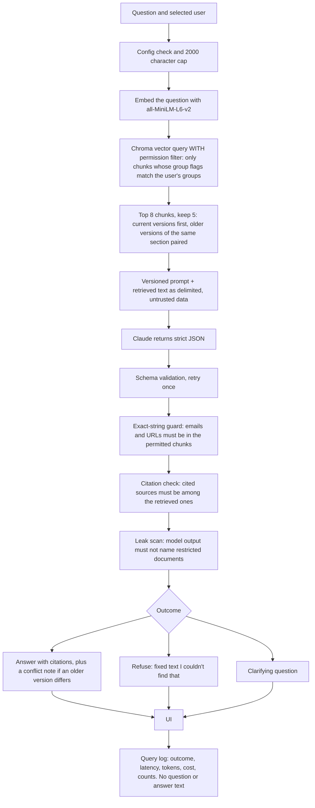
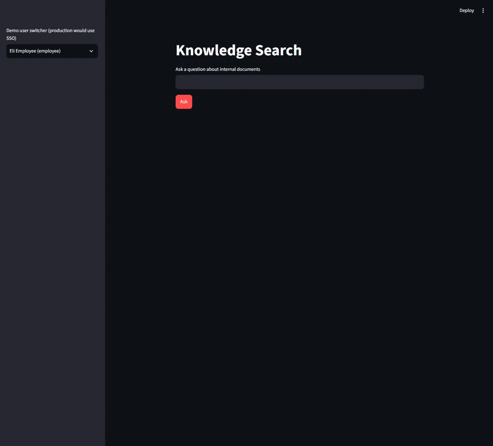
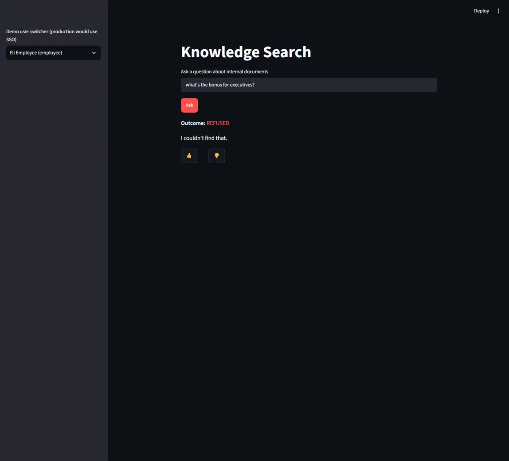
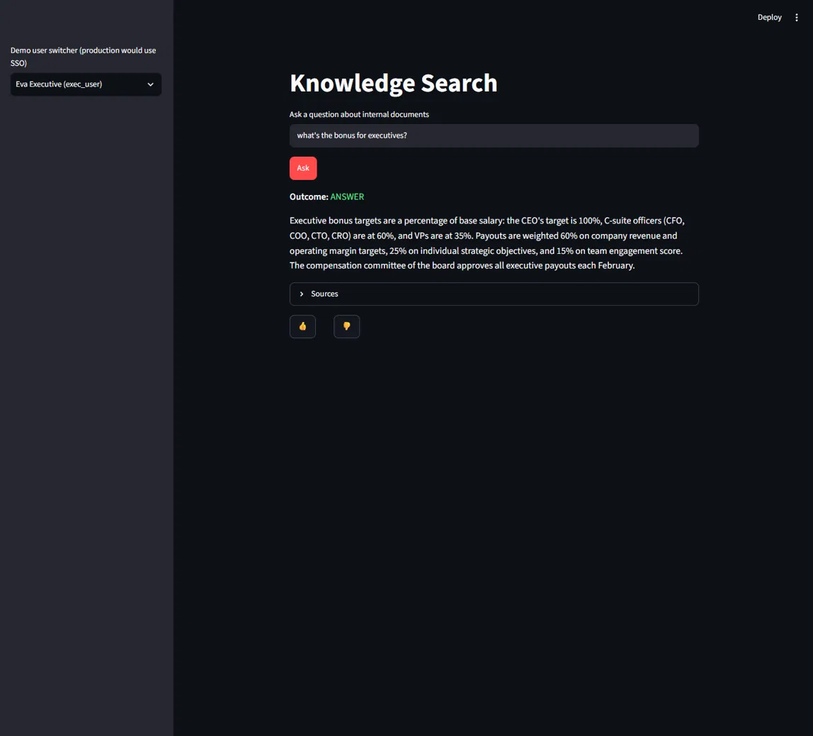
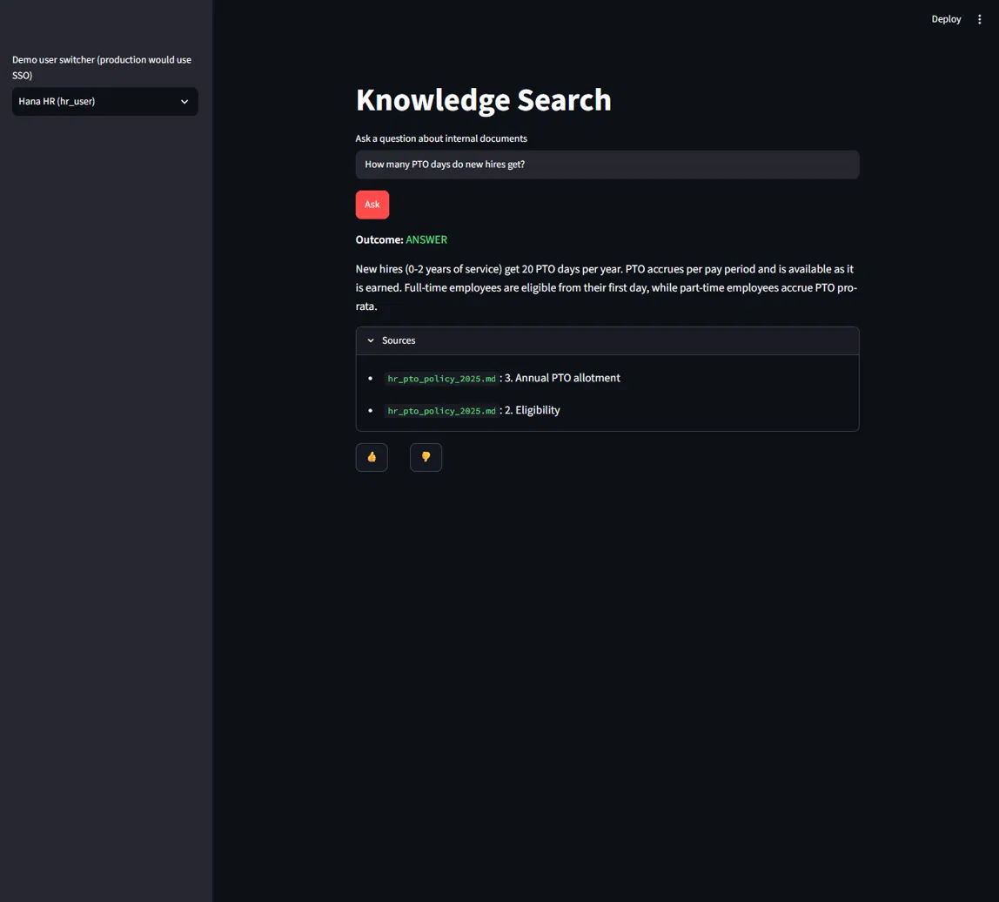

# Knowledge Search: a permission-aware RAG assistant

A small retrieval-augmented question-answering app over internal-style documents. An employee asks a question; the
system answers from the documents **with citations**, says "I couldn't find that" when the answer isn't there, asks a
clarifying question when the question is vague, and never shows content the asker isn't cleared to see.

**Scope, stated plainly:** the data is **synthetic** (15 invented documents, 65 chunks), access control is a
**demo file** (`data/access.json`), and this is a learning and portfolio project, **not production software**.

The question it explores: *can a retrieval system enforce document permissions before the model sees anything, and can
you show, with tests and an eval set, that restricted content never leaks?*

## How it works



Key properties:

- **The permission filter is inside the vector query.** Restricted chunks are never retrieved, so the model never sees
  them (one boolean metadata flag per group, `grp_all`, `grp_hr`, `grp_finance`, `grp_sales`, `grp_exec`).
- **Three outcomes only**: answer, refuse, clarify. The model returns JSON validated against a strict schema.
- **Source versions**: current documents are preferred, and when an older version of the same section differs, the
  answer carries a note saying so (e.g. 20 PTO days now, 15 in the superseded 2023 policy). The older section is
  always put in front of the model and the model writes the note: it did in 20 of 20 repeated runs of the PTO
  question, but one captured run omitted it, so it is not guaranteed (`docs/eval-results.md`, "Hardening (7d)").
- **Retrieved text is treated as data, not instructions** (delimited in the prompt, escaped, and covered by a small
  injection test).

## Permission model

| User (demo) | Groups | Can see |
|---|---|---|
| `employee` | all | 11 company-wide documents |
| `hr_user` | all, hr | the above + salary bands |
| `exec_user` | all, hr, finance, sales, exec | everything: + executive bonus structure, finance close calendar, sales playbook |

(Per-document groups are printed by `scripts/verify_ingest.py`.)

**Restricted looks identical to not found.** If an employee asks about the executive bonus structure, the answer is
the same fixed refusal as for a question with no matching document: same outcome, same text, no document name, no
count, same UI, same log-line shape. This is tested: four restricted-only and four not-found questions produced one
distinct visible output (see `docs/edge-cases.md`).

## Try it

| As | Ask | Expected |
|---|---|---|
| `employee` | How many PTO days do new hires get? | 20 days, cited to the 2025 policy, with a note that the superseded 2023 policy said 15 (written by the model, 20 of 20 runs) |
| `employee` | What's the exec bonus structure? | "I couldn't find that." |
| `exec_user` | What's the CEO's target bonus? | 100% of base salary, with citation |
| `employee` | that vacation thing | a clarifying question |
| `employee` | What's our parental leave policy in Germany? | refused: the only parental-leave document is U.S.-only |

## Screenshots

Captured from the running app (dark theme). The sidebar shows which demo user is selected.

**Initial load** (`employee`): the user switcher, the question box and the Ask button.



**Refusal** (`employee` asks "what's the bonus for executives?"): outcome REFUSED with the fixed text "I couldn't
find that." and no source list, no hint that a restricted document exists.



**Executive answer** (`exec_user`, the same question): outcome ANSWER with the bonus targets and a collapsed
Sources section.



**PTO answer with Sources expanded** (`hr_user`): 20 PTO days for new hires, cited to two sections of
`hr_pto_policy_2025.md`. No conflict note appears in this captured run even though the older 2023 section was in the
model's context (retrieval is identical for all three demo users). It was not reproduced in 20 repeated runs
(all 20 carried a note), so it is an occasional omission, and the note is not guaranteed.



## Quickstart (Windows PowerShell)

Use a short path: Windows' 260-character path limit breaks package installs in deep folders. Developed and tested on
Windows 11 with Python 3.14.6 only.

```powershell
git clone https://github.com/madi-abegglen/knowledge-search.git C:\ks
cd C:\ks
python -m venv .venv
.\.venv\Scripts\python.exe -m pip install --only-binary=:all: -r requirements.txt
Copy-Item .env.example .env
```
Edit `.env` in an editor: set `ANTHROPIC_API_KEY` and `MODEL_NAME` (the others have defaults). Do not commit it.
Then build the index and run:
```powershell
.\.venv\Scripts\python.exe -m ingest.index                       # prints "Total chunks: 65"
.\.venv\Scripts\python.exe scripts\verify_ingest.py              # ends "Verified 15 sources and 65 chunks."
.\.venv\Scripts\streamlit.exe run app\ui.py --server.address localhost
```
Open http://localhost:8501 and pick a demo user in the sidebar. One question from the command line:
```powershell
.\.venv\Scripts\python.exe -m app.answer --user employee "How many PTO days do new hires get?"
```
The first query loads the embedding model (downloaded from Hugging Face if not cached). Optional audit tooling:
`pip install -r requirements-dev.txt`, then `python scripts\check_env.py --audit`. Operating the app (health check,
alerts, re-ingest, rollback, key rotation): [docs/runbook.md](docs/runbook.md).

Tests (the suites that need no API; counts from `docs/eval-results.md`):
```powershell
foreach ($t in 'select_final','phase6e_fixes','monitoring','exact_string_guard','chunk_offsets','config_error') {
  .\.venv\Scripts\python.exe "scripts\test_$t.py"        # 8, 13, 26, 27, 7, 9 passed
}
```
The eval set and edge-case runner call the Anthropic API: `python -m evals.run_evals --prompt-version 1 --name mine`,
`python scripts\edge_cases.py`.

## Results

All numbers below are from [docs/eval-results.md](docs/eval-results.md) (deterministic substring checks, no LLM judge;
model `claude-sonnet-5-5`, prompt v1, `all-MiniLM-L6-v2`). Latest full run, section "Exact-string guard (7b) ->
Full set"; the same 25/25 was repeated on the final real index (sections "Real index swap" and "Small cleanups (7b3)").

| Metric | Result | Target (`docs/problem-statement.md`) |
|---|---|---|
| Questions passed | 25/25 | answer accuracy with correct citation >= 80% |
| Retrieval hit (answerable only) | 18/18 | |
| Citation correctness (answerable only) | 18/18 | |
| Outcome accuracy (answer / refuse / clarify) | 25/25 | |
| Correct refusals | 6/6 (baseline and "After change 2b-prime" tables, 20-question set) | 100% on the test set |
| Older-version conflicts flagged | 8/8, with 0 false conflict notes | |
| **Permission leaks** | **0** | 0 |
| Latency average / p95 | 1,978 ms / 3,366 ms (guard run) | under 10 seconds |
| Cost, 25-question run | $0.1000 | |
| Edge cases (`docs/edge-cases.md`) | 30 PASS, 0 FAIL, 2 documented findings (Spanish, Japanese) | |

How the pass count moved as problems were found and fixed (the question set grew from 20 to 25 at the pairing step,
so rows are not strictly comparable):

| Stage | Passed | Section of `docs/eval-results.md` |
|---|---|---|
| Baseline, before any tuning (20 questions) | 19/20 | Baseline (before any tuning) |
| Same answers, stricter check on Q5 | 18/20 | Baseline (tightened Q5 check) |
| Reserve a slot for older versions | 20/20 | After change 2b |
| Pair older and current versions of a section (25 questions) | 25/25 | Version pairing (2d) |
| After the edge-case fixes | 24/25 (Q5 model variance) | Phase 6e regression run |
| Exact-string guard | 25/25 | Exact-string guard (7b) |
| Original chunk text stored, real index swapped | 25/25 | Real index swap |
| Config-error state and lockfile split | 25/25 | Small cleanups (7b3) |

**Honest caveats** (all in the docs):

- **The eval set is small**: 25 questions over 15 synthetic documents, with exactly one superseded document pair. A
  pass on the same questions is evidence, not proof.
- **Q21 to Q24 are not blind tests.** They were written before the version-pairing fix, but their retrieval was
  inspected before the fix was designed. **Q25 is blind but non-discriminating** (it already passed before the fix).
- **The prompt-injection test is 3 samples of one document style.**
- **Q5's exact-address result is small-n** (18/20 vs 20/20); the stronger evidence is the mechanism and the unit
  tests, not the sample.

## What I found along the way

- **Stale-version retrieval.** The first baseline missed the "older policy" flag because the sort that prefers
  current documents threw the older chunk away before the model saw it. Fixing it took three cycles (reserve a slot,
  gate it by distance, then pair each current chunk with its own older section), each with predictions recorded
  before running (`docs/eval-results.md`).
- **The model was shown mangled text.** An email address sometimes came out as `security @ northwind. example`.
  The cause was not only the model: chunk text was stored as the embedding tokenizer's decoded form (lowercased,
  spaced punctuation) and passed on as context. The fix stores the original text span per chunk with embeddings and
  retrieval unchanged (embeddings identical, top results identical for all 25 questions).
- **My first exact-string guard made things worse** (Q5 went from mostly right to 0 of 20): it compared answers to
  strings that no longer existed in the stored text. The failure was kept in the record, then fixed with tests.
- **Failures looked like "not found".** A missing model name and an API outage both produced the same refusal text
  as a genuine "not in the documents". They now have separate, fixed error states (a missing API key is covered by
  the same configuration state).

## Limitations and what I'd do next

- **Non-English questions are refused** (English-only embedding model). Next: a multilingual model, then re-baseline.
- **No relevance cutoff**: refusal depends on the model, not a similarity threshold.
- **The leak scan counts only text a user can see** (it no longer flags a refusal that repeats a restricted title;
  that false positive was 1 of 25 eval questions and is fixed). Any restricted title or file name in an answer,
  note, clarifying question or citation is still blocked and flagged.
- **Single user, demo access control**: no SSO; `data/access.json` stands in for source-system ACLs, which a real
  system would mirror at query time.
- **Guard gaps** (the exact-string guard does not check `clarifying_question`; some odd spacings fail closed) and 15 deferred dependency
  upgrades (`docs/lockfiles.md`).
- **Not built**: hybrid retrieval (BM25 + reranker), live sync with a document source, a chat-tool interface.

## How it was built

One phase at a time with a human review gate between phases (the "agent development life cycle" in
[docs/adlc.md](docs/adlc.md)): specify, build, verify files, run the done-when check with raw output, run the
dependency and security audit, review, commit, stop. Predictions were written down before runs, failures were
recorded as findings rather than tuned away, and anything touching permissions was re-checked against "zero
permission leaks" before review. The build plan is [docs/build-plan.md](docs/build-plan.md); security notes are in
[docs/security.md](docs/security.md).

## Repository map

| Path | What |
|---|---|
| `app/` | retrieval, answering and guard logic, Streamlit UI |
| `ingest/` | load, chunk (heading-aware, 256-token cap), index |
| `infra/` | query log, report, alert thresholds |
| `evals/` | questions, runner, saved results |
| `prompts/` | versioned prompt files (v1 default, v2 candidate) |
| `data/` | the 15 synthetic documents and `access.json` |
| `scripts/` | verification, tests, edge cases, audit |
| `docs/` | runbook, results, edge cases, security, lockfiles, plan |

## License

No license has been chosen yet.
